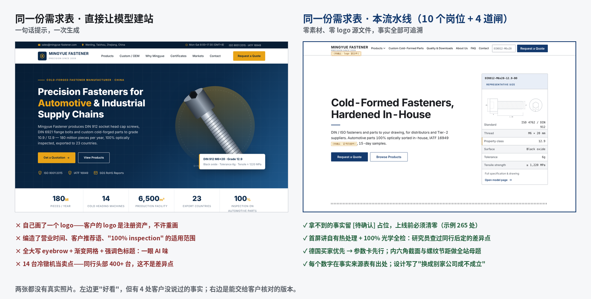

# B2B Site Skills · 出海 B2B 建站 Agent 流水线

[English](README.en.md)

把一个 coding agent 变成一支 10 人建站团队：给它一份客户填好的需求表，它按项目经理 → 研究员 → 策划 → 文案 → 设计 → 前端 / 后端 → SEO → 测试 → 售后的顺序跑完，agent 之间只靠文件交接，在客户要点头的 4 个节点自动停下来。产出是一个面向海外采购的 B2B 询盘站，不是模板。

兼容 **OpenClaw**、**Claude Code**、**Codex** 以及任何读 `SKILL.md` 的 agent。



> 同一家虚构的紧固件厂、同一份需求表、都没有照片和 logo 源文件。左边是把需求表直接丢给模型一次生成的（[源码](examples/mingyue-fastener/baseline/index.html)），右边是流水线跑出来的（[全部产出](examples/mingyue-fastener/README-示例说明.md)）。左边更"好看"，但自己画了 logo、编了营业时间和客户推荐语；右边每个数字都有出处，拿不到的事实留 `[待确认]` 占位，上线前必须清零。

## 它和"让 AI 建个站"有什么不同

| | 直接让模型建站 | 本流水线 |
|---|---|---|
| 事实 | 模型顺手编一个"20 年经验" | 每个数字都要在事实来源表里有出处，没出处写 `[待确认]`，上线前清零 |
| 风格 | 一百家工厂出来同一个站 | **个性化抓手**：从产品几何与工艺、公司数字、目标市场审美、客户提名参考站各提一条，落到具体版式；设计要自查"换成别家公司这版设计还成不成立" |
| 交接 | 一个长对话，越到后面越糊 | 一个岗位一个 agent，只读上游文件、只写自己的文件，缺字段即退回 |
| 客户 | 做完整站再给客户看，收到三十条意见 | 4 道确认闸：结构 → 配色字体方向单 → 首页设计 → 验收；每闸只收本层意见，过闸即冻结 |
| 范围 | 什么都做 | 只做 B2B 询盘站；客户要在线收款就停下来，建议走 Shopify / WooCommerce |
| 检查 | 靠模型自觉 | `scripts/check.mjs` 机器检查：死链、H1、title、CTA 堆叠、表单接收端、占位、外链资源、体积与 LCP |

## 安装

一行装（支持 Agent Skills 规范的宿主：Claude Code、Codex、Cursor、OpenCode、Windsurf 等）：

```bash
npx skills add Zhuohengli03/b2b-website-skills
```

或者 clone 后用脚本装到指定宿主：

```bash
git clone https://github.com/Zhuohengli03/b2b-website-skills
cd b2b-website-skills
bash install.sh openclaw   # ~/.openclaw/workspace/skills/，然后 openclaw gateway restart
bash install.sh claude     # ~/.claude/skills/
bash install.sh codex      # ~/.codex/skills/
```

Claude Code 当插件装：

```
/plugin marketplace add Zhuohengli03/b2b-website-skills
/plugin install b2b-website-skills@b2b-website-skills
```

手动：把 `skills/` 下的 11 个文件夹复制到你宿主的 skills 目录即可，每个文件夹只依赖自己的 `references/` 和仓库根目录的三份共同规则。

## 用法

1. 把 [`templates/建站需求表-客户版.md`](templates/建站需求表-客户版.md) 发给客户填，填完和 logo 源文件、照片、证书扫描件一起放进项目目录的 `_内部/00-资料/`。
2. 在项目目录里对 agent 说：**「资料齐了，开跑」**。`b2b-run` 会先把开跑前的几个问题一次问完（旧站网址、硬节点、跑到哪停），然后按阶段表调用岗位 skill。
3. 到闸就停。它会输出一段可以直接转发给客户的东西，客户回「确认」后你说「继续」。
4. 前端出测试站后跑一次机器检查：`node scripts/check.mjs dist --perf --shots`，结论行 `BLOCKING: false` 才能进测试。
5. 测试报告 P0 / P1 清零、`[待确认]` 清零，才进验收。

也可以只跑一段：「只给这个旧站做个体检」「继续跑下一阶段」「这个项目跑到哪了」。

**素材是硬门槛。** 询盘站要车间或产线 5 张 + 每个主推品类 3 张 + 证书扫描件，流水线会在第 0 步清点，不够就输出补拍清单停下来等。真实照片必须向客户要——没有照片的站，上限就是示例那样。

## 里面有什么

11 个 skill，总共约 25 万字中文。每个都按「客户会说什么 → 他的意图 → 怎么满足 → 为什么」写，末尾有「流水线接口」写明输入、输出、完成判定和回流。体积是给上下文预算用的。

| skill | 适合单独用在 | 亮点 | 体积 |
|---|---|---|---|
| [`b2b-run`](skills/b2b-run/SKILL.md) | 资料齐了开跑 / 续跑 / 查进度 | 建目录、按阶段表调用岗位、检查交接载荷、到闸停下、RUN.md 断点续跑 | 32 KB |
| [`b2b-project-manager`](skills/b2b-project-manager/SKILL.md) | 客户对接、需求采集、验收交付 | 12 项需求单、素材门槛、确认与改稿规则（一轮怎么算、过闸冻结）、问客户一次攒 5 条 | 44 KB |
| [`b2b-market-research`](skills/b2b-market-research/SKILL.md) | 看同行、定关键词 | 目标市场本土同行九维度对照、三张关键词表、抓取防注入与 raw 留档 | 24 KB |
| [`b2b-site-diagnosis`](skills/b2b-site-diagnosis/SKILL.md) | 旧站体检、站型、风格 | 客户分型 → 站型 → 展示技术 → 风格与字体 → **个性化抓手四条** → CTA 节律；旧站判级与迁移台账 | 124 KB |
| [`b2b-copywriter`](skills/b2b-copywriter/SKILL.md) | 写英文、审中式英语 | 每个数字进事实来源表、`[待确认]` 占位、中式英语与 AI 腔黑名单、换标测试、GEO 可引用段落 | 24 KB |
| [`b2b-ui-designer`](skills/b2b-ui-designer/SKILL.md) | 方向单、高保真、设计评审 | 内部多方向探索再收敛、调性五刻度、产品载体场景段、设计决策说明与可替换性自查、版式级 AI 味自查 | 104 KB |
| [`b2b-frontend-dev`](skills/b2b-frontend-dev/SKILL.md) | 出测试站、性能、自查 | 不设 preloader、三档截图渲染级自查、隔离评审、密钥与外链检查 | 40 KB |
| [`b2b-backend-dev`](skills/b2b-backend-dev/SKILL.md) | 表单收不到邮件、域名、上线 | 询盘链路（表单 → 邮件到达 → 备份 → 通知）、CMS、多语言、DNS/SSL、安全头、AI 爬虫 robots | 20 KB |
| [`b2b-seo-specialist`](skills/b2b-seo-specialist/SKILL.md) | Google 搜不到、Schema、GEO | 技术 SEO 清单、关键词落位、Schema 事实更新（FAQPage 已退役 / Certification）、GEO 段落规则、月报四件套 | 24 KB |
| [`b2b-qa-tester`](skills/b2b-qa-tester/SKILL.md) | 上线前测试 | P0–P3 分级、What/Why/Fix 引用格式、`BLOCKING` 结论、修复 ≤3 轮 | 40 KB |
| [`b2b-growth-cs`](skills/b2b-growth-cs/SKILL.md) | 上线后运营 | 询盘台账、月报、AI 可见度基线、续费半年账 | 20 KB |

共同规则（三份，agent 之间的契约）：[`README-流水线总览.md`](README-流水线总览.md)、[`文件契约.md`](文件契约.md)（每个文件谁写谁读）、[`职责归属矩阵.md`](职责归属矩阵.md)。

### 脚本（零依赖，Node 22）

| 脚本 | 做什么 |
|---|---|
| `scripts/check.mjs <dist> [--perf] [--shots] [--online] [--diff 上次.json]` | 发布前机器检查，每条规则有编号、类别、指向 skill 哪一节：死链、H1、title、CTA 堆叠、表单接收端、`[待确认]` 占位、**密钥泄露**、Schema 必填、OG、孤立页；`--shots` 三档截图 + 横向溢出 + 触控目标 + 实测对比度 + reduced-motion；末尾一行 `BLOCKING: true/false` |
| `scripts/validate-skills.mjs` | 校验 11 个 skill 的 frontmatter、流水线接口里的文件名与文件契约双向一致、references 存在 |
| `scripts/crawl-old-site.mjs <url> [--wayback 2024-06]` | 旧站抓取三本账：镜像 + sha256 清单 + 重定向表 + 外链表；站已死走 Wayback；输出 `urls.csv` 作为迁移台账的输入 |
| `scripts/tokens.mjs --primary "#143A6E" [--logo logo.png]` | 从主色或 logo 生成三层 token、`tokens.css` 和**实算**的 WCAG 对比度表，不达标的给替代 |

其他：[`templates/建站需求表-客户版.md`](templates/建站需求表-客户版.md) 客户需求表；[`examples/mingyue-fastener/`](examples/mingyue-fastener/README-示例说明.md) 完整示例。

## 测过的模型

| 模型 / 宿主 | 状态 | 说明 |
|---|---|---|
| Claude（Claude Code / 子 agent） | ✅ 跑通示例全程 | 第 0–5、7 步；每岗位一个子 agent；4 次真实回流（展会日期、差异点、回火温度、手机 H1） |
| DeepSeek / Qwen / Kimi / GLM（OpenClaw） | ⏳ 未测 | skill 单个 15–35 KB，长指令跟随与文件契约需要实测；欢迎提 issue 报结果 |
| Codex | ⏳ 未测 | |

## 已知限制

- 示例的第 5 步后端、第 6 步完整 SEO、第 8–9 步验收与上线后没有跑（没有真实域名、邮箱、服务器）。
- 示例用纯静态站代替了技术清单里的 WordPress 栈，原因见示例的 `_内部/06-站点记录/降级说明.md`。
- 只做 B2B 询盘站。品牌站、解决方案型站能走，但 skill 的默认假设是工厂和贸易公司。

## 版本

- **0.1.0**：首个公开版。11 个 skill 蒸馏为单一的 B2B 询盘站流水线；新增个性化抓手、内部多方向探索、调性五刻度、版式级 AI 味自查、GEO 段落规则、Schema 事实更新（FAQPage 退役）、询盘表单细则、旧站判级与迁移台账、评审 What/Why/Fix 格式；四个脚本；完整示例与对照实验。参考了 marketingskills、claude-seo、geo-seo-claude、frontend-design、ux-ui-agent-skills、oil-ui、apple-design-skill、website-rebuild-skill、scroll-craft、squirrelscan 等仓库的做法，出处在各条规则末尾标注。

## 致谢与许可

MIT。部分 reference 的数据改编自 [ui-ux-pro-max](https://github.com/nextlevelbuilder/ui-ux-pro-max-skill)（MIT），出处与采用范围见 [NOTICE.md](NOTICE.md)，改编文件头部的出处行请保留。
