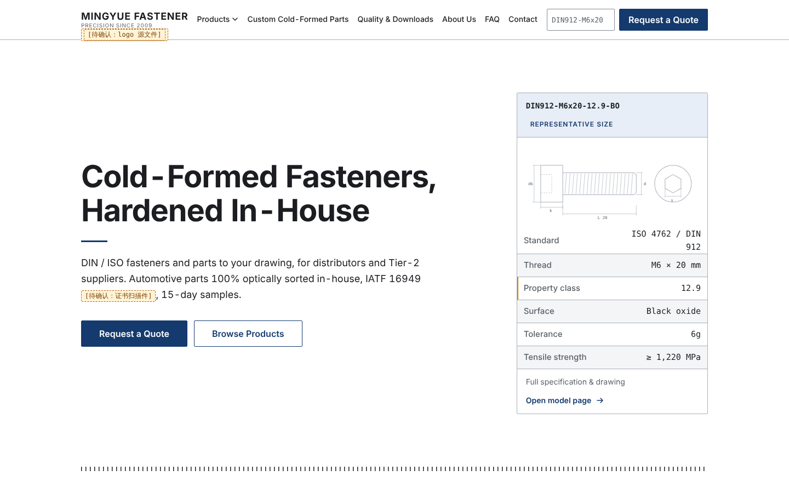
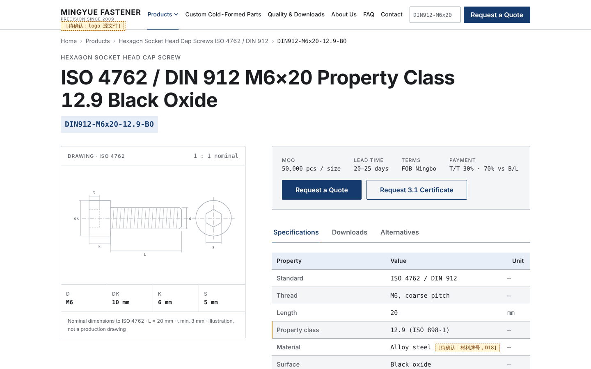

# 示例项目 · 台州铭岳紧固件（虚构）

> 公司、产品、数据全部为本仓库 demo 编造，与任何真实公司无关。

这是用本仓库的流水线从一份需求表（设定：这家公司的外贸经理自己填、自己跑）跑到测试站的完整产出，**没有一张真实照片、没有 logo 源文件**，所有图形是 agent 用内联 SVG 画的；所有拿不到的事实都留 `[待确认]` 占位，上线前必须清零。

## 看什么

| 想看 | 打开 |
|---|---|
| 输入：你填的需求表 | `_内部/00-资料/需求表.md` |
| 每一步谁做了什么、停在哪、回流了什么 | `_内部/RUN.md`、`_内部/确认记录.md` |
| 10 个岗位的产出 | `_内部/01-需求/` → `02-研究/` → `03-方案/` → `04-文案/` → `05-设计/` → `06-站点记录/` → `08-测试/` |
| 流水线攒下来要问你的 44 个问题 | `_内部/待用户决定.md` |
| 个性化抓手怎么从产品推到版式 | `_内部/03-方案/风格与字体方向.md` 的「个性化抓手」节、`_内部/05-设计/设计决策说明.md` 的「抓手落地」与可替换性自查 |
| 成品站 | `node build.mjs` 生成 `dist/`，`npx serve dist` 预览 |
| 机器检查 | `node ../../scripts/check.mjs dist --perf --shots` |
| 对照实验：同一份需求表直接让模型一次生成的首页 | `baseline/index.html`、`screenshots/compare.png` |

## 这次运行的事实

- 模型：Claude（本仓库作者的会话），每个岗位一个子 agent，按文件交接
- 没跑的：第 5 步后端（没有真实域名、邮箱、服务器）、第 6 步完整 SEO（基础项并进前端）、第 8–9 步验收与上线交接、上线后
- 每道闸 demo 默认确认（拍板人设定为你本人）
- 结果：18 页静态站，首页 92 KB、LCP 124 ms；测试结论「不可上线」——P0 1（表单接收端未配）、P1 20（占位未清零等）
- 回流 4 次：展会日期与官方不符、设备台数不是差异点、回火温度写错、手机首屏 H1 超三行

